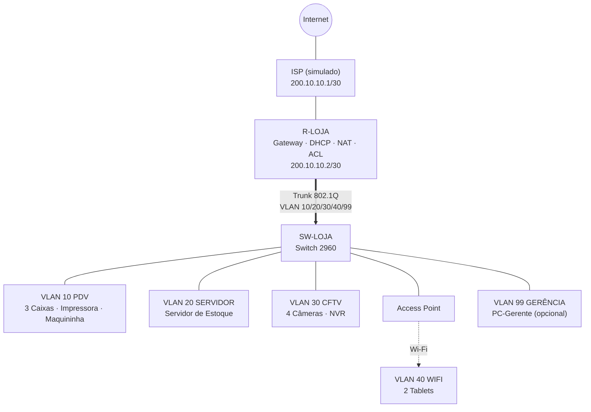

Checklist: SmartRetail Network (Ana Fashion)

> [!info] Pesos da nota
> **Parte Prática (Packet Tracer): 50%** · Relatório PDF: 25% · Vídeo pitch (até 4 min): 25%
> A prática é a base dos outros dois. Comece por ela.

## 📅 Sexta 13/11: Planejar + Parte Prática
**Planejamento (manhã)**
- [ ] Ler o PDF de orientações até o fim e anotar os requisitos
- [ ] Listar os equipamentos: 3 caixas, 2 tablets, 1 impressora, 1 máquina de cartão, 1 servidor de estoque, 4 câmeras IP
- [ ] Definir os equipamentos de rede: roteador/gateway, switch(es), access point
- [ ] Decidir a segmentação (VLANs). Sugestão de grupos:
    - [ ] Vendas/PDV (caixas, máquina de cartão, impressora)
    - [ ] Servidor de estoque
    - [ ] CFTV (câmeras, isoladas do resto)
    - [ ] Wi-Fi dos tablets
- [ ] Montar o plano de endereçamento IPv4 (rede, máscara, gateway, faixa DHCP por VLAN)
- [ ] Definir quais dispositivos terão **IP estático** (servidor, câmeras, impressora, gateways) e quais usarão **DHCP**
- [ ] Definir as regras de segurança (quem acessa o servidor, CFTV isolado, Wi-Fi com WPA2/WPA3)

**Packet Tracer (tarde/noite)**
- [ ] Montar a topologia com todos os dispositivos
- [ ] Ligar os cabos (cabeados) e o access point (sem fio)
- [ ] Configurar as VLANs e as portas do switch (access/trunk)
- [ ] Configurar o gateway/roteamento entre VLANs
- [ ] Configurar o DHCP e o DNS
- [ ] Configurar IPs estáticos nos dispositivos definidos
- [ ] Configurar o Wi-Fi dos tablets (SSID + senha)
- [ ] Aplicar a segurança básica (ACLs, isolamento do CFTV)
- [ ] Conectar a saída para a Internet (nuvem/ISP)
- [ ] Salvar o arquivo `.pkt` e fazer uma cópia de backup

> [!tip] Câmeras no Packet Tracer
> Se não houver ícone de câmera IP na sua versão, use um dispositivo que a represente (PC/Server/IoT) e explique isso no relatório.

## 📅 Sábado 14/11: Testes + Relatório + Roteiro
**Testes e evidências**
- [ ] **Testes de conectividade** (ping e outros):
    - [ ] Caixas → servidor de estoque ✔
    - [ ] Tablets → servidor de estoque ✔
    - [ ] Câmeras → servidor/gravação ✔
    - [ ] Acesso bloqueado onde deve ser bloqueado (ex.: tablet → CFTV) ✔
    - [ ] Acesso à Internet ✔
- [ ] Tirar **prints**: topologia, configurações, tabela de IPs, resultados dos testes

**Relatório técnico em PDF (25%)**
- [ ] Diagnóstico das necessidades da Ana Fashion
- [ ] Proposta geral da arquitetura
- [ ] Justificativa da topologia e dos equipamentos
- [ ] Plano de endereçamento IPv4 (tabela)
- [ ] Dispositivos com IP estático vs DHCP
- [ ] Proposta de segmentação
- [ ] Principais serviços de rede (DHCP, DNS, gateway...)
- [ ] Controles básicos de segurança
- [ ] Justificativa de crescimento futuro (VLANs/faixas reservadas, portas livres no switch, novo AP)
- [ ] Responder à pergunta final: *"Como estruturar uma rede de pequeno porte que integre vendas, estoque, pagamentos, móveis e CFTV com segurança, disponibilidade e expansão?"*
- [ ] Inserir o diagrama e os prints
- [ ] Conferir se o relatório bate com a rede do Packet Tracer
- [ ] Exportar em **PDF**

**Vídeo (preparação)**
- [ ] Escrever o roteiro (problema → arquitetura → equipamentos → endereçamento/segmentação → integração → testes → benefícios)
- [ ] Ensaiar cronometrando (< 4 min)

## 📅 Domingo 15/11: Vídeo + Revisão + Entrega
- [ ] Gravar o vídeo com a tela do Packet Tracer (até 4 min)
- [ ] Subir no YouTube (pode ser **não listado**)
- [ ] Abrir o link em aba anônima e confirmar que funciona
- [ ] Reler o PDF e conferir os 3 entregáveis
- [ ] Entregar no AVA ✅ (de preferência antes do meio-dia)

> [!warning] Antes de enviar
> O PDF de orientações pede para verificar se o link do vídeo está correto e acessível.

> [!tip] Se o tempo apertar
> Priorize nesta ordem: **Packet Tracer → relatório → vídeo**. Se sobrar tempo no sábado, grave o vídeo já nesse dia para o domingo ser só de entrega.
# Plano Técnico

> [!info] Resumo da arquitetura
> Topologia em **estrela**, com **1 roteador (gateway, DHCP, NAT e ACLs)** e **1 switch** ligados por um **trunk 802.1Q** (*router-on-a-stick*). A rede é dividida em **VLANs**, e o CFTV fica isolado. Um **access point** atende os tablets. A expansão é feita com VLANs e portas reservadas.

## 1. Topologia



## 2. VLANs e sub-redes

| VLAN | Nome | Rede | Máscara | Gateway | Faixa DHCP |
|---|---|---|---|---|---|
| 10 | PDV | 10.10.10.0/24 | 255.255.255.0 | 10.10.10.1 | .100 a .199 |
| 20 | SERVIDOR | 10.10.20.0/24 | 255.255.255.0 | 10.10.20.1 | sem DHCP (estático) |
| 30 | CFTV | 10.10.30.0/24 | 255.255.255.0 | 10.10.30.1 | sem DHCP (estático) |
| 40 | WIFI | 10.10.40.0/24 | 255.255.255.0 | 10.10.40.1 | .100 a .199 |
| 99 | GERENCIA | 10.10.99.0/24 | 255.255.255.0 | 10.10.99.1 | sem DHCP (estático) |
| 50 | *(reservada)* | 10.10.50.0/24 | | | Administrativo (futuro) |
| 60 | *(reservada)* | 10.10.60.0/24 | | | Wi-Fi visitantes (futuro) |

**WAN:** R-LOJA `200.10.10.2/30` ↔ ISP `200.10.10.1/30`.

## 3. Dispositivos, IPs e portas do switch

| Dispositivo | VLAN | IP | Tipo | Porta SW |
|---|---|---|---|---|
| Caixa 1, 2 e 3 | 10 | 10.10.10.100 a .199 | **DHCP** | Fa0/1, Fa0/2, Fa0/3 |
| Impressora de rede | 10 | 10.10.10.10 | **Estático** | Fa0/4 |
| Maquininha de cartão | 10 | 10.10.10.11 | **Estático** | Fa0/5 |
| Servidor de estoque | 20 | 10.10.20.10 | **Estático** | Fa0/6 |
| Câmeras 1 a 4 | 30 | 10.10.30.11 a .14 | **Estático** | Fa0/7 a Fa0/10 |
| NVR (gravação local) | 30 | 10.10.30.10 | **Estático** | Fa0/11 |
| Access Point | 40 | n/a (modo bridge) | n/a | Fa0/12 |
| Tablet 1 e 2 | 40 | 10.10.40.100 a .199 | **DHCP** (Wi-Fi) | via AP |
| PC-Gerente *(opcional)* | 99 | 10.10.99.10 | **Estático** | Fa0/13 |
| SW-LOJA (gerência) | 99 | 10.10.99.2 | **Estático** | n/a |
| Portas livres | n/a | n/a | desligadas (*shutdown*) | Fa0/14 a Fa0/24 |
| Uplink para o roteador | trunk | n/a | n/a | Gi0/1 |

**Dispositivos no Packet Tracer:** Router 2911 · Switch 2960-24TT · Access Point-PT · Tablet PC · Printer-PT · Server-PT (estoque e NVR) · PC-PT (caixas, maquininha, câmeras e PC-Gerente).

> [!tip] Câmeras e maquininha
> Se não houver ícone próprio, represente com PC ou Server e diga isso no relatório.

## 4. Configuração: ISP (simulado)

```
enable
configure terminal
hostname ISP
interface GigabitEthernet0/0
 ip address 200.10.10.1 255.255.255.252
 no shutdown
interface Loopback0
 ip address 8.8.8.8 255.255.255.255
end
write memory
```

## 5. Configuração: SW-LOJA

```
enable
configure terminal
hostname SW-LOJA
no ip domain-lookup
vlan 10
 name PDV
vlan 20
 name SERVIDOR
vlan 30
 name CFTV
vlan 40
 name WIFI
vlan 99
 name GERENCIA
!
interface range FastEthernet0/1-5
 switchport mode access
 switchport access vlan 10
interface FastEthernet0/6
 switchport mode access
 switchport access vlan 20
interface range FastEthernet0/7-11
 switchport mode access
 switchport access vlan 30
interface FastEthernet0/12
 switchport mode access
 switchport access vlan 40
interface FastEthernet0/13
 switchport mode access
 switchport access vlan 99
interface range FastEthernet0/14-24
 shutdown
!
interface GigabitEthernet0/1
 switchport mode trunk
 switchport trunk allowed vlan 10,20,30,40,99
!
interface Vlan99
 ip address 10.10.99.2 255.255.255.0
 no shutdown
ip default-gateway 10.10.99.1
end
write memory
```

## 6. Configuração: R-LOJA

```
enable
configure terminal
hostname R-LOJA
no ip domain-lookup
!
interface GigabitEthernet0/0
 description WAN-ISP
 ip address 200.10.10.2 255.255.255.252
 ip nat outside
 no shutdown
!
interface GigabitEthernet0/1
 description TRUNK-SW-LOJA
 no ip address
 no shutdown
!
interface GigabitEthernet0/1.10
 description PDV
 encapsulation dot1Q 10
 ip address 10.10.10.1 255.255.255.0
 ip nat inside
interface GigabitEthernet0/1.20
 description SERVIDOR
 encapsulation dot1Q 20
 ip address 10.10.20.1 255.255.255.0
 ip nat inside
interface GigabitEthernet0/1.30
 description CFTV
 encapsulation dot1Q 30
 ip address 10.10.30.1 255.255.255.0
interface GigabitEthernet0/1.40
 description WIFI
 encapsulation dot1Q 40
 ip address 10.10.40.1 255.255.255.0
 ip nat inside
interface GigabitEthernet0/1.99
 description GERENCIA
 encapsulation dot1Q 99
 ip address 10.10.99.1 255.255.255.0
 ip nat inside
!
! ---------- DHCP ----------
ip dhcp excluded-address 10.10.10.1 10.10.10.99
ip dhcp excluded-address 10.10.10.200 10.10.10.254
ip dhcp excluded-address 10.10.40.1 10.10.40.99
ip dhcp excluded-address 10.10.40.200 10.10.40.254
!
ip dhcp pool PDV
 network 10.10.10.0 255.255.255.0
 default-router 10.10.10.1
 dns-server 10.10.20.10 8.8.8.8
ip dhcp pool WIFI
 network 10.10.40.0 255.255.255.0
 default-router 10.10.40.1
 dns-server 10.10.20.10 8.8.8.8
!
! ---------- NAT + rota padrão ----------
access-list 1 permit 10.10.0.0 0.0.255.255
ip nat inside source list 1 interface GigabitEthernet0/0 overload
ip route 0.0.0.0 0.0.0.0 200.10.10.1
end
write memory
```

> [!warning] Aplique as ACLs só no final
> Primeiro confirme que **tudo pinga** sem ACL. Depois cole o bloco da seção 8 e refaça os testes.

## 7. Configuração: servidores e dispositivos

- **Servidor de estoque:** IP `10.10.20.10`, máscara `255.255.255.0`, gateway `10.10.20.1`, DNS `10.10.20.10`.
    - Aba *Services*: **HTTP** ligado e **DNS** ligado.
    - Registro DNS: `estoque.anafashion.local` → `10.10.20.10`.
- **NVR:** IP `10.10.30.10`, máscara `255.255.255.0`, gateway `10.10.30.1`.
- **Câmeras:** `10.10.30.11` a `.14`, máscara `255.255.255.0`, gateway `10.10.30.1`.
- **Impressora:** `10.10.10.10`, e **maquininha:** `10.10.10.11`, ambas com máscara `255.255.255.0` e gateway `10.10.10.1`.
- **PC-Gerente:** `10.10.99.10`, máscara `255.255.255.0`, gateway `10.10.99.1`.
- **Caixas:** IP Configuration → **DHCP**.
- **Access Point:** Port 1 → SSID `AnaFashion-Tablets`, autenticação **WPA2-PSK**, senha à sua escolha.
- **Tablets:** Config → Wireless0 → mesmo SSID e senha, IP por **DHCP**.

## 8. ACLs de segurança (aplicar por último)

```
configure terminal
!
ip access-list extended ACL-PDV
 deny ip 10.10.10.0 0.0.0.255 10.10.30.0 0.0.0.255
 deny ip 10.10.10.0 0.0.0.255 10.10.40.0 0.0.0.255
 deny ip 10.10.10.0 0.0.0.255 10.10.99.0 0.0.0.255
 permit ip any any
!
ip access-list extended ACL-WIFI
 permit tcp 10.10.40.0 0.0.0.255 host 10.10.20.10 eq 80
 permit tcp 10.10.40.0 0.0.0.255 host 10.10.20.10 eq 443
 permit udp 10.10.40.0 0.0.0.255 host 10.10.20.10 eq 53
 permit icmp 10.10.40.0 0.0.0.255 host 10.10.20.10
 deny ip 10.10.40.0 0.0.0.255 10.10.10.0 0.0.0.255
 deny ip 10.10.40.0 0.0.0.255 10.10.20.0 0.0.0.255
 deny ip 10.10.40.0 0.0.0.255 10.10.30.0 0.0.0.255
 deny ip 10.10.40.0 0.0.0.255 10.10.99.0 0.0.0.255
 permit ip any any
!
ip access-list extended ACL-SERVIDOR
 deny ip 10.10.20.0 0.0.0.255 10.10.30.0 0.0.0.255
 permit ip any any
!
ip access-list extended ACL-CFTV
 permit tcp 10.10.30.0 0.0.0.255 10.10.99.0 0.0.0.255 established
 permit icmp 10.10.30.0 0.0.0.255 10.10.99.0 0.0.0.255 echo-reply
 deny ip any any
!
interface GigabitEthernet0/1.10
 ip access-group ACL-PDV in
interface GigabitEthernet0/1.20
 ip access-group ACL-SERVIDOR in
interface GigabitEthernet0/1.30
 ip access-group ACL-CFTV in
interface GigabitEthernet0/1.40
 ip access-group ACL-WIFI in
end
write memory
```

## 9. Matriz de testes (para os prints)

| Origem | Destino | Esperado |
|---|---|---|
| Caixa 1 | Servidor `10.10.20.10` (ping e `estoque.anafashion.local` no navegador) | ✅ |
| Caixa 1 | Impressora `10.10.10.10` | ✅ |
| Caixa 1 | Internet `8.8.8.8` | ✅ |
| Caixa 1 | Câmera `10.10.30.11` | ❌ bloqueado (ACL) |
| Caixa 1 | Tablet | ❌ bloqueado (ACL) |
| Tablet | Servidor `10.10.20.10` (ping e HTTP) | ✅ |
| Tablet | Internet `8.8.8.8` | ✅ |
| Tablet | Caixa ou câmera | ❌ bloqueado (ACL) |
| Câmera | NVR `10.10.30.10` | ✅ (mesma VLAN) |
| PC-Gerente | NVR e câmeras | ✅ |
| Servidor | Câmera | ❌ bloqueado (ACL) |

**Comandos para print:** `show vlan brief` · `show ip interface brief` · `show ip dhcp binding` · `show access-lists` · `show running-config` · `show ip nat translations`

## 10. Ordem de montagem (sexta 13/11)
- [ ] Posicionar os dispositivos e ligar os cabos (cabo automático do PT)
- [ ] Configurar o ISP (seção 4)
- [ ] Configurar o SW-LOJA (seção 5)
- [ ] Configurar o R-LOJA (seção 6)
- [ ] Configurar servidor, NVR, câmeras, impressora e PCs (seção 7)
- [ ] Configurar o AP e os tablets
- [ ] Testar tudo **sem ACL** (todos pingam)
- [ ] Aplicar as ACLs (seção 8)
- [ ] Rodar a matriz de testes e tirar os prints (seção 9)
- [ ] Salvar o `.pkt` e fazer uma cópia de backup

## 11. Justificativas prontas para o relatório
- **Topologia em estrela com roteador e switch:** é simples de gerenciar, e uma falha em um cabo isola só aquele equipamento.
- **VLANs:** separam vendas, estoque, CFTV, Wi-Fi e gerência. Isso reduz o broadcast e limita o alcance de uma invasão.
- **CFTV isolado:** as câmeras só se comunicam com o NVR e a gerência, e não têm acesso à Internet nem às VLANs de vendas.
- **IP estático:** servidor, NVR, câmeras, impressora e maquininha precisam de endereço fixo para serem localizados de forma confiável.
- **DHCP:** caixas e tablets recebem a configuração automaticamente, o que facilita trocar ou adicionar equipamentos.
- **DNS interno:** os caixas acessam o estoque por nome (`estoque.anafashion.local`).
- **NAT:** os IPs privados compartilham um único IP público.
- **WPA2-PSK:** protege o acesso Wi-Fi dos tablets.
- **Expansão:** há VLANs 50 e 60 reservadas, portas livres no switch, faixas de IP sobrando e espaço para novos APs. Também é possível migrar para um switch L3 sem refazer o endereçamento.