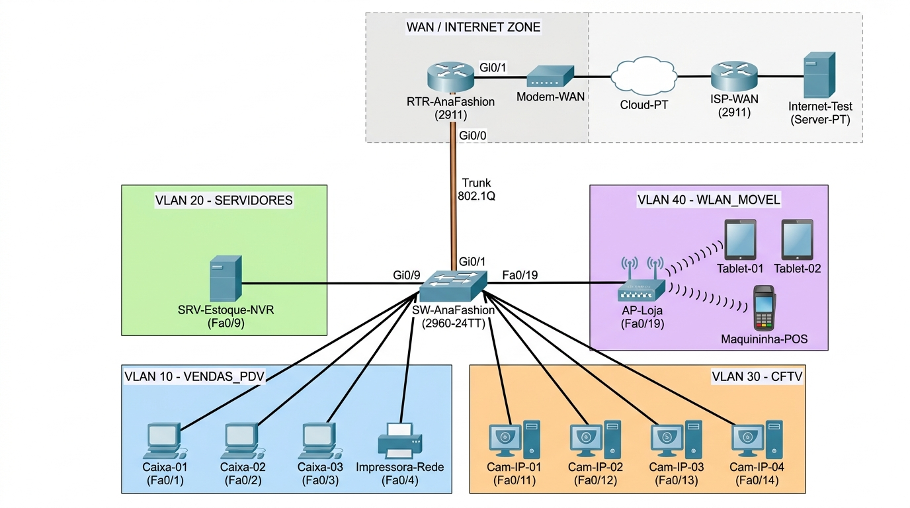

# Guia de Montagem Física da Topologia (Passo 4) — SmartRetail Network

Este guia detalha o posicionamento dos equipamentos, a localização dos ícones no Cisco Packet Tracer e o cabeamento exato porta a porta para montar a topologia em [main.pkt](file:///home/radiant/DevHub/Projeto-SmartRetail-Network-UniFECAF/dist/main.pkt), seguindo integralmente [plano_rede.md](file:///home/radiant/DevHub/Projeto-SmartRetail-Network-UniFECAF/dist/plano_rede.md).

Diagrama visual de referência: [guia_topologia_passo4.jpg](file:///home/radiant/DevHub/Projeto-SmartRetail-Network-UniFECAF/dist/guia_topologia_passo4.jpg)

> **Atenção visual na imagem de apoio:** Próximo ao switch na esquerda aparece o texto `Gi0/9` por detalhe gráfico da ilustração, mas a porta física correta do `SRV-Estoque-NVR` no `Switch 2960-24TT` é **`FastEthernet0/9`** (`Fa0/9`), conforme indicado abaixo do ícone do servidor e na tabela da Seção 2.

---

## 1. Inventário e Localização dos Ícones no Packet Tracer

Adicione à área de trabalho lógica (*Logical Workspace*) os seguintes dispositivos e altere o **Display Name** de cada um:

### 1.1 Infraestrutura e Simulação WAN (`Network Devices` / `End Devices`)
| Tipo de Dispositivo | Display Name | Modelo no PT | Onde encontrar no Packet Tracer |
| :--- | :--- | :--- | :--- |
| Roteador / Gateway da Loja | `RTR-AnaFashion` | `2911` | `Network Devices > Routers > 2911` |
| Switch Principal L2 | `SW-AnaFashion` | `2960-24TT` | `Network Devices > Switches > 2960-24TT` |
| Access Point Wi-Fi | `AP-Loja` | `AP-PT` (`AccessPoint-PT`) | `Network Devices > Wireless Devices > AP-PT` |
| Modem WAN *(ponte L1 passiva)* | `Modem-WAN` | `Cable Modem` | `Network Devices > WAN Emulation > Cable Modem` |
| Nuvem WAN | `Cloud-PT` | `PT-Cloud` | `Network Devices > WAN Emulation > PT-Cloud` |
| Roteador Operadora ISP | `ISP-WAN` | `2911` | `Network Devices > Routers > 2911` |
| Servidor Externo Internet | `Internet-Test` | `Server-PT` | `End Devices > End Devices > Server` |

### 1.2 Dispositivos Finais da Loja (`End Devices`)
| Tipo de Dispositivo | Qtd | Display Name | Modelo no PT | Onde encontrar no Packet Tracer |
| :--- | :---: | :--- | :--- | :--- |
| Caixas Registradoras (PDV) | 3 | `Caixa-01`, `Caixa-02`, `Caixa-03` | `PC-PT` | `End Devices > End Devices > PC` |
| Impressora de Rede | 1 | `Impressora-Rede` | `Printer-PT` | `End Devices > End Devices > Printer` |
| Servidor Local (Estoque + NVR) | 1 | `SRV-Estoque-NVR` | `Server-PT` | `End Devices > End Devices > Server` |
| Câmeras IP (CFTV — *substituto*) | 4 | `CAM-IP-01` a `CAM-IP-04` | `PC-PT` | `End Devices > End Devices > PC` |
| Tablets de Atendimento | 2 | `Tablet-01`, `Tablet-02` | `TabletPC-PT` | `End Devices > End Devices > Tablet` |
| Maquininha de Cartão (*substituto*) | 1 | `Maquininha-POS` | `Smartphone-PT` | `End Devices > End Devices > Smartphone` |

---

## 2. Mapa de Conexões Porta a Porta — Rede Interna (LAN)

Selecione o cabo **Copper Straight-Through** (linha preta contínua em `Connections`) para todas as conexões abaixo no **`SW-AnaFashion` (`Switch 2960-24TT`)**:

| Grupo / VLAN | Porta no Switch (`SW-AnaFashion`) | Equipamento Conectado | Porta no Equipamento | Tipo de Cabo |
| :--- | :--- | :--- | :--- | :--- |
| **Trunk 802.1Q (Core)** | **`GigabitEthernet0/1`** | `RTR-AnaFashion` (`2911`) | `GigabitEthernet0/0` | `Copper Straight-Through` |
| **VLAN 10 (`VENDAS_PDV`)** | **`FastEthernet0/1`** | `Caixa-01` (`PC-PT`) | `FastEthernet0` | `Copper Straight-Through` |
| **VLAN 10 (`VENDAS_PDV`)** | **`FastEthernet0/2`** | `Caixa-02` (`PC-PT`) | `FastEthernet0` | `Copper Straight-Through` |
| **VLAN 10 (`VENDAS_PDV`)** | **`FastEthernet0/3`** | `Caixa-03` (`PC-PT`) | `FastEthernet0` | `Copper Straight-Through` |
| **VLAN 10 (`VENDAS_PDV`)** | **`FastEthernet0/4`** | `Impressora-Rede` (`Printer-PT`) | `FastEthernet0` | `Copper Straight-Through` |
| **VLAN 20 (`SERVIDORES`)** | **`FastEthernet0/9`** | `SRV-Estoque-NVR` (`Server-PT`) | `FastEthernet0` | `Copper Straight-Through` |
| **VLAN 30 (`CFTV`)** | **`FastEthernet0/11`** | `CAM-IP-01` (`PC-PT`) | `FastEthernet0` | `Copper Straight-Through` |
| **VLAN 30 (`CFTV`)** | **`FastEthernet0/12`** | `CAM-IP-02` (`PC-PT`) | `FastEthernet0` | `Copper Straight-Through` |
| **VLAN 30 (`CFTV`)** | **`FastEthernet0/13`** | `CAM-IP-03` (`PC-PT`) | `FastEthernet0` | `Copper Straight-Through` |
| **VLAN 30 (`CFTV`)** | **`FastEthernet0/14`** | `CAM-IP-04` (`PC-PT`) | `FastEthernet0` | `Copper Straight-Through` |
| **VLAN 40 (`WLAN_MOVEL`)** | **`FastEthernet0/19`** | `AP-Loja` (`AP-PT`) | `Port 0` | `Copper Straight-Through` |

### Portas Reservadas para Escalabilidade (Não conectar agora)
- `Fa0/5` a `Fa0/8`: reserva para expansão de caixas/periféricos na VLAN 10.
- `Fa0/10`: reserva para servidor secundário na VLAN 20.
- `Fa0/15` a `Fa0/18`: reserva para novas câmeras IP na VLAN 30.
- `Fa0/20` a `Fa0/24`: reserva para novos Access Points ou futura VLAN 50/60.
- `Gi0/2`: reserva para uplink de segundo switch de acesso.

---

## 3. Dispositivos Sem Fio (`AP-Loja` — VLAN 40)

Os três dispositivos móveis utilizam interface sem fio **`Wireless0`** e **não recebem cabo físico**:

- `Tablet-01` (`TabletPC-PT`) → posicionado na área `VLAN 40` próximo ao `AP-Loja` (`Port 1`).
- `Tablet-02` (`TabletPC-PT`) → posicionado na área `VLAN 40` próximo ao `AP-Loja` (`Port 1`).
- `Maquininha-POS` (`Smartphone-PT`) → posicionado na área `VLAN 40` próximo ao `AP-Loja` (`Port 1`).

> **Nota:** Enquanto não configuramos o SSID corporativo `AnaFashion-Corp` e a senha WPA2-PSK (o que será feito no **Passo 7**), é normal que eles apareçam provisoriamente ligados ao SSID `Default` ou desconectados.

---

## 4. Mapa de Conexões — Enlace Externo (WAN / Internet)

No Cisco Packet Tracer, a `Cloud-PT` não realiza ponte direta entre duas portas Ethernet; por isso o **`Modem-WAN` (`Cable Modem`)** atua como ponte passiva de Camada 1 (sem IP e sem comandos CLI) ligando a saída Ethernet do roteador da loja ao enlace coaxial da nuvem até o roteador da operadora `ISP-WAN`:

| Origem | Porta Origem | Destino | Porta Destino | Tipo de Cabo |
| :--- | :--- | :--- | :--- | :--- |
| `RTR-AnaFashion` (`2911`) | `GigabitEthernet0/1` | `Modem-WAN` (`Cable Modem`) | `Port 1` (Ethernet) | `Copper Straight-Through` |
| `Modem-WAN` (`Cable Modem`) | `Port 0` (Coaxial) | `Cloud-PT` (`PT-Cloud`) | `Coaxial7` | `Coaxial` *(azul escuro)* |
| `Cloud-PT` (`PT-Cloud`) | `Ethernet6` | `ISP-WAN` (`2911`) | `GigabitEthernet0/0` | `Copper Straight-Through` |
| `ISP-WAN` (`2911`) | `GigabitEthernet0/1` | `Internet-Test` (`Server-PT`) | `FastEthernet0` | `Copper Cross-Over` |

> **Dica prática:** Se houver dúvida entre cabo direto e cruzado nos enlaces da WAN, utilize o ícone **Automatically Choose Connection Type (Raio)** depois de conectar o cabo `Coaxial` manualmente entre `Modem-WAN` e `Cloud-PT`.

### Configuração Obrigatória dentro da `Cloud-PT` (Ponte Coaxial ↔ Ethernet)
Sem este vínculo interno, a nuvem não encaminha pacotes até o `ISP-WAN`:
1. Clique em **`Cloud-PT`** e abra a aba **`Config`**.
2. No menu lateral esquerdo, acesse **`CONNECTIONS` → `Cable`**.
3. Em **From Port**, selecione **`Coaxial7`**.
4. Em **To Port**, selecione **`Ethernet6`**.
5. Clique em **`Add`** e verifique se o mapeamento aparece na lista abaixo.

---

## 5. Checklist de Verificação Antes de Avançar

- [x] Todos os **12 dispositivos finais**, **3 equipamentos de rede internos** (`RTR-AnaFashion`, `SW-AnaFashion`, `AP-Loja`) e **4 elementos WAN** (`Modem-WAN`, `Cloud-PT`, `ISP-WAN`, `Internet-Test`) estão posicionados e renomeados no Packet Tracer.
- [x] Todas as portas do `SW-AnaFashion` correspondem exatamente à tabela da Seção 2 (`Gi0/1`, `Fa0/1`–`Fa0/4`, `Fa0/9`, `Fa0/11`–`Fa0/14`, `Fa0/19`).
- [x] Os cabos do Switch para os equipamentos finais acenderam (triângulos verdes ou âmbar durante convergência STP). *(As portas `Gi0/0` e `Gi0/1` dos roteadores `RTR-AnaFashion` e `ISP-WAN` permanecem **vermelhas** até aplicarmos as configurações nos **Passos 5 e 6**).*
- [x] A ponte `Coaxial7 <-> Ethernet6` foi adicionada em `Cloud-PT > Config > CONNECTIONS > Cable`.
- [x] O arquivo foi salvo em [main.pkt](file:///home/radiant/DevHub/Projeto-SmartRetail-Network-UniFECAF/dist/main.pkt).
