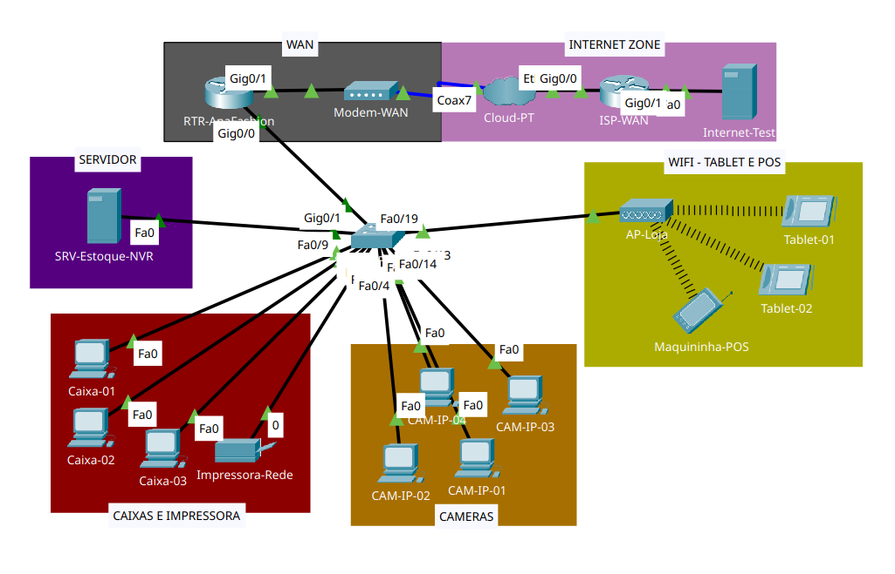
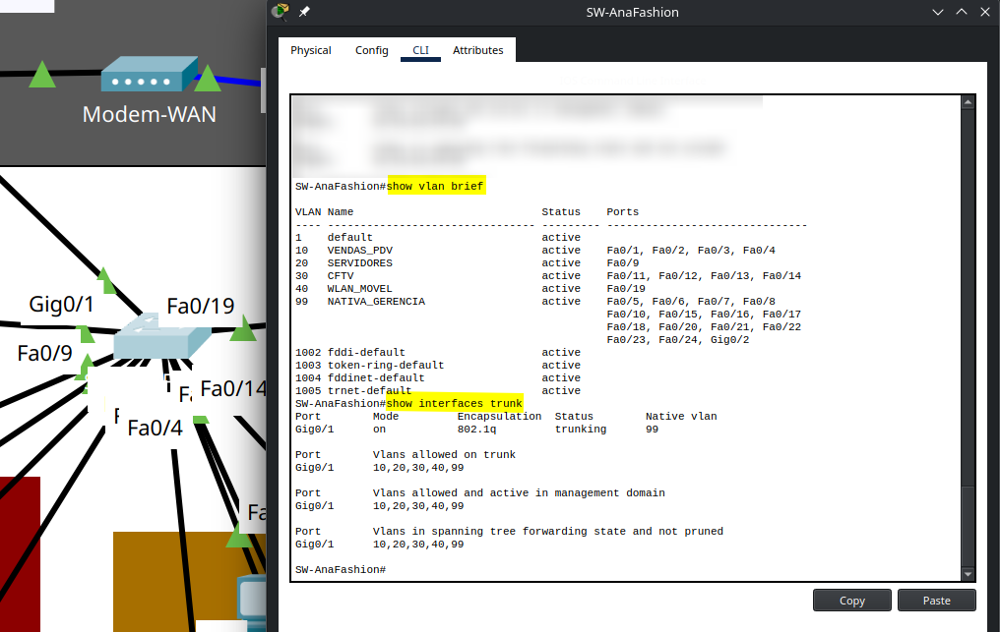
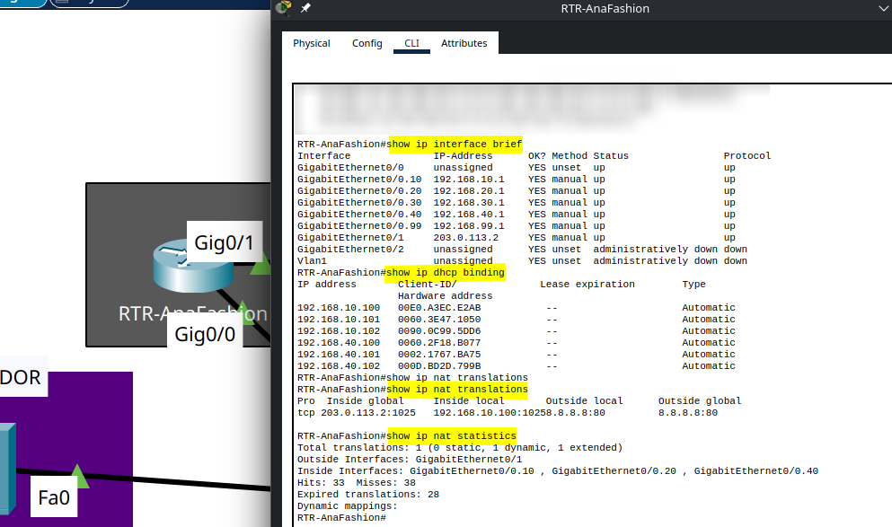
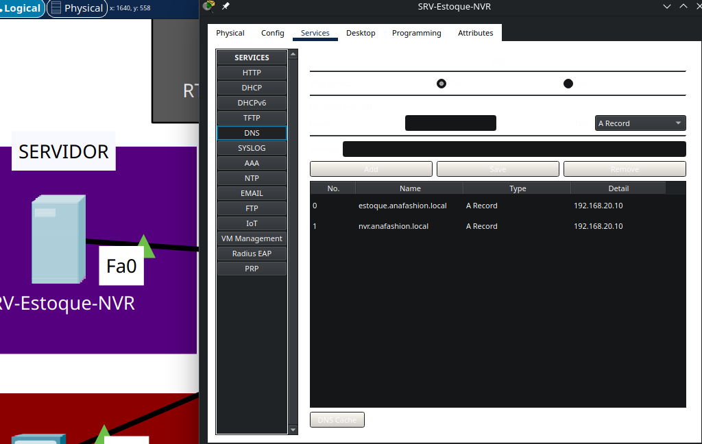
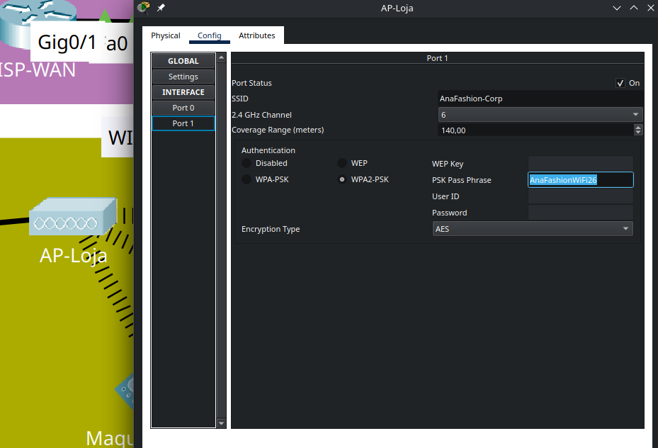
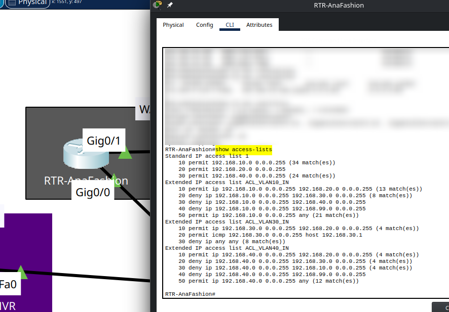
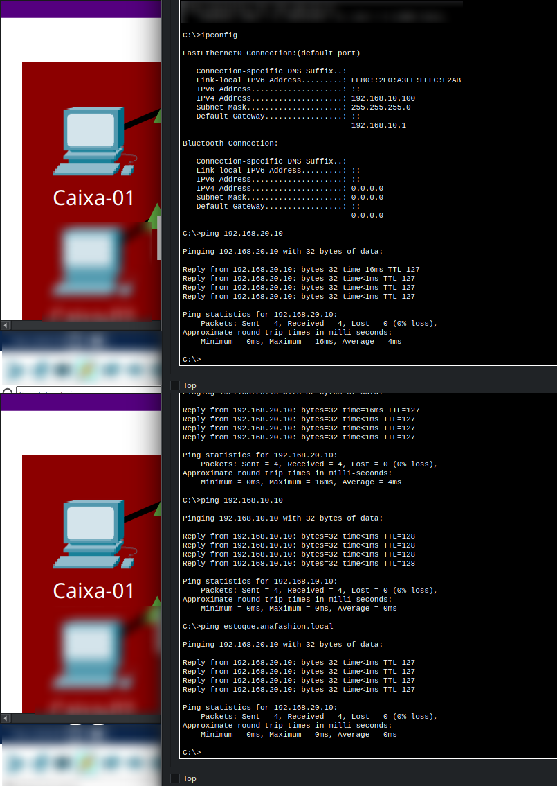
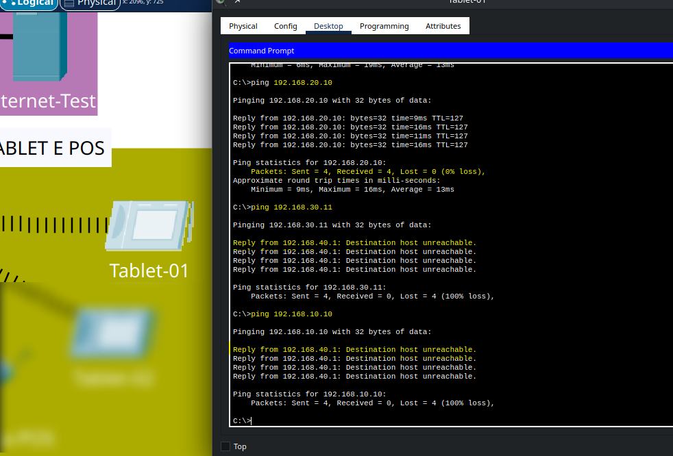
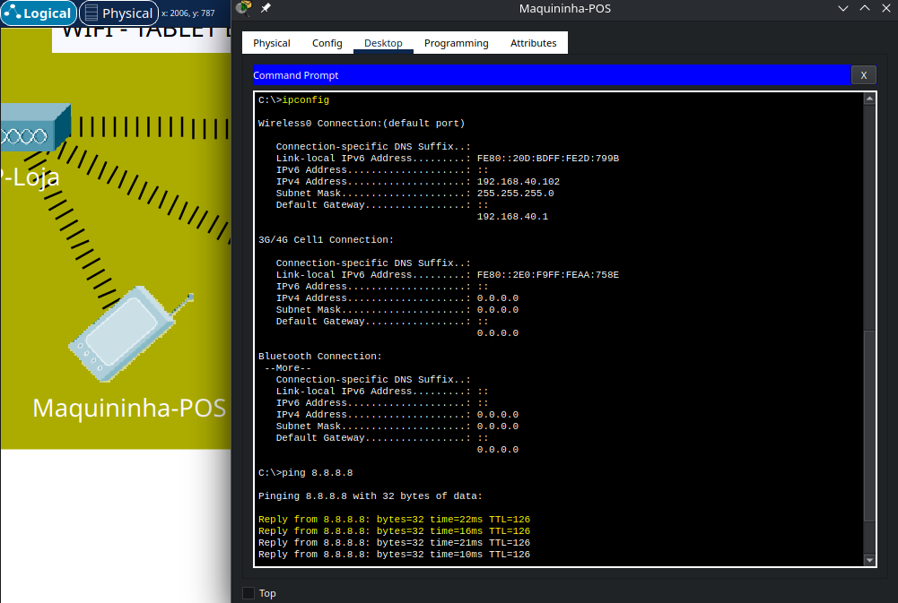
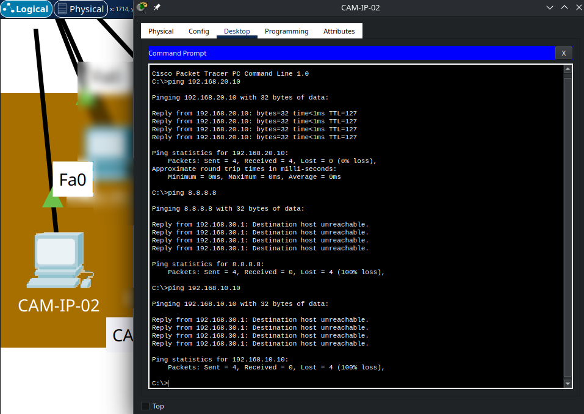

# Relatório Técnico — Projeto SmartRetail Network (Ana Fashion)

**Instituição:** UniFECAF — Disciplina *Computer Network* (Redes de Computadores)  
**Cliente:** Loja de Roupas Ana Fashion  
**Data:** 15/11/2026  
**Artefato Prático de Referência:** `dist/main.pkt` (Cisco Packet Tracer)  

---

## 1. Diagnóstico das Necessidades da Ana Fashion

A **Ana Fashion** é uma loja de roupas em processo de expansão que enfrenta gargalos operacionais por não possuir uma infraestrutura de rede corporativa estruturada, segura e escalável. O crescimento do volume de vendas, a adoção de atendimento móvel no salão e a necessidade de vigilância contínua exigem uma rede capaz de integrar todos os ativos sem comprometer disponibilidade nem segurança.

Os principais requisitos e dores diagnosticados são:

- **Continuidade de vendas e estoque (Crítico):** Os 3 caixas registradores (PDV) precisam acessar simultaneamente o servidor local de estoque sem interrupções, colisões de tráfego ou divergências de saldo.
- **Isolamento e continuidade do CFTV:** As 4 câmeras IP gravam continuamente no servidor/NVR local, gerando fluxo constante de vídeo que deve permanecer **segmentado logicamente** do tráfego administrativo, de vendas e de dispositivos sem fio.
- **Mobilidade corporativa (WLAN):** Os 2 tablets de atendimento no salão e a maquininha de cartão inteligente exigem rede Wi-Fi estável, autenticada e integrada ao roteamento corporativo.
- **Compartilhamento de periféricos:** A impressora de rede deve atender de forma previsível às estações de caixa sem perda de mapeamento por troca de endereço.
- **Escalabilidade sem retrabalho:** A solução deve permitir adicionar novos caixas, câmeras, dispositivos móveis e futuras redes (como Wi-Fi de visitantes) sem reconstruir a topologia física.

---

## 2. Proposta Geral da Arquitetura

Para atender à loja com equilíbrio entre robustez corporativa, custo compatível com pequeno porte e facilidade de manutenção, projetou-se uma arquitetura **hierárquica enxuta de duas camadas (Acesso L2 + Roteamento/Borda L3)** baseada no modelo **Router-on-a-Stick** com segmentação lógica por **VLANs (IEEE 802.1Q)**.

Os pilares implementados na topologia em `dist/main.pkt` são:

- **Comutação Centralizada em Camada 2 (`SW-AnaFashion` — `Switch 2960-24TT`):** Conecta todas as estações cabeadas (caixas, impressora, servidor, câmeras IP e Access Point) em topologia física em **Estrela**, utilizando portas *Access* segregadas por VLAN e um enlace **Trunk 802.1Q** na porta `Gig0/1` até o roteador.
- **Roteamento Inter-VLAN, Serviços e Segurança (`RTR-AnaFashion` — `Router 2911`):** Centraliza os gateways de todas as VLANs via sub-interfaces lógicas (`Gi0/0.10`, `.20`, `.30`, `.40` e `.99`), fornece DHCP dinâmico para os segmentos operacionais, aplica **Listas de Controle de Acesso Estendidas (ACLs)** por zona e executa **NAT Overload (PAT)** na saída WAN (`Gi0/1`).
- **Acesso Sem Fio Transparente (`AP-Loja` — `AccessPoint-PT`):** Opera como ponte Camada 2 conectada à VLAN sem fio (`VLAN 40`), permitindo que o roteador principal gerencie endereçamento e filtragem dos tablets e da maquininha POS.
- **Servidor Convergente Local (`SRV-Estoque-NVR` — `Server-PT`):** Concentra o sistema de estoque/vendas, a gravação contínua do CFTV (NVR) e o serviço DNS interno corporativo.
- **Simulação WAN / Internet (`Modem-WAN` → `Cloud-PT` → `ISP-WAN` → `Internet-Test`):** Emula a ligação da loja à operadora e a um destino público externo (`8.8.8.8`) para validação ponta a ponta da saída Internet.

> *Figura 1 — Topologia lógica completa implementada no Cisco Packet Tracer (`dist/prints/01_topologia_geral.png`), evidenciando todas as conexões cabeadas ativas (verde), conexões sem fio no `AP-Loja` e o enlace WAN.*

---

## 3. Justificativa da Topologia, Equipamentos e Substitutos no Packet Tracer

### 3.1 Topologia Física e Lógica Escolhida
Adotou-se a **topologia física em Estrela** centrada no switch `SW-AnaFashion` combinada à **topologia lógica *Router-on-a-Stick***. Em estrela, falhas em um cabo individual afetam apenas aquele equipamento, mantendo o restante da loja operando normalmente; já o *Router-on-a-Stick* evita o custo de um switch Layer 3 dedicado para uma loja de pequeno porte, permitindo interconectar e filtrar múltiplas VLANs por um único link Gigabit Ethernet Trunk (`Gi0/1 ↔ Gi0/0`).

### 3.2 Equipamentos de Infraestrutura e WAN
| Tipo de Dispositivo | Hostname | Modelo no PT | Justificativa Técnica |
| :--- | :--- | :--- | :--- |
| **Roteador / Gateway** | `RTR-AnaFashion` | `Router 2911` | Dispõe de 3 interfaces GigabitEthernet integradas (`Gi0/0`, `Gi0/1`, `Gi0/2`), suportando sub-interfaces 802.1Q, DHCP, NAT/PAT e ACLs estendidas sem módulos adicionais. |
| **Switch Principal L2** | `SW-AnaFashion` | `Switch 2960-24TT` | Fornece 24 portas FastEthernet e 2 portas GigabitEthernet. Atende todos os 11 links cabeados atuais mantendo mais de 50% das portas livres para crescimento futuro. |
| **Access Point Wi-Fi** | `AP-Loja` | `AccessPoint-PT` | Atua em modo *bridge* Camada 2 (evitando o NAT duplo e DHCP paralelo de roteadores domésticos como `HomeRouter-PT-AC`), mantendo a política centralizada no `RTR-AnaFashion`. |
| **Modem WAN** *(ponte L1)* | `Modem-WAN` | `Cable-Modem-PT` | Conversor passivo Ethernet ↔ Coaxial exigido pela arquitetura do simulador para encaminhar tráfego entre o roteador da loja e a nuvem `Cloud-PT`. |
| **Nuvem WAN** | `Cloud-PT` | `PT-Cloud` | Representa o meio WAN da operadora com vínculo interno `Coaxial7 ↔ Ethernet6`. |
| **Roteador Operadora ISP** | `ISP-WAN` | `Router 2911` | Nó externo de simulação acoplado após a nuvem para rotear o enlace WAN (`203.0.113.0/30`) até a rede externa simulada (`8.8.8.0/24`). |
| **Servidor Externo Internet** | `Internet-Test` | `Server-PT` | Simula um servidor público externo (`8.8.8.8`) para comprovar acesso real à Internet e tradução NAT/PAT. |

### 3.3 Dispositivos Finais e Justificativa dos Substitutos no Packet Tracer
Todos os **12 dispositivos finais** exigidos no escopo foram implementados, adotando substitutos tecnicamente equivalentes onde o simulador não oferece ícone nativo com terminal CLI completo:

| Tipo de Dispositivo | Qtd | Hostname / Rótulo | Dispositivo no PT | Justificativa da Representação / Contorno |
| :--- | :---: | :--- | :--- | :--- |
| **Caixas Registradoras (PDV)** | 3 | `Caixa-01`, `Caixa-02`, `Caixa-03` | `PC-PT` *(nativo)* | Estações desktop cabeadas executam o sistema de frente de caixa e possuem `Command Prompt` completo para testes DHCP e conectividade. |
| **Tablets de Atendimento** | 2 | `Tablet-01`, `Tablet-02` | `TabletPC-PT` *(nativo)* | Dispositivos móveis nativos com interface `Wireless0`, suporte a WPA2-PSK, DHCP e `Command Prompt` para testes de acesso e bloqueio. |
| **Impressora de Rede** | 1 | `Impressora-Rede` | `Printer-PT` *(nativo)* | Periférico nativo com interface `FastEthernet0`, IP estático e resposta ICMP para validação pelos caixas. |
| **Servidor Local (Estoque + NVR)** | 1 | `SRV-Estoque-NVR` | `Server-PT` *(nativo)* | Centraliza o banco de estoque, o armazenamento CFTV (NVR) e o serviço DNS interno. |
| **Maquininha de Cartão (POS)** | 1 | `Maquininha-POS` | `Smartphone-PT` *(substituto)* | O Packet Tracer não possui ícone nativo de terminal POS/TEF. Maquininhas modernas (Smart POS) operam como dispositivos móveis inteligentes via Wi-Fi; o `Smartphone-PT` reproduz fielmente a conexão wireless via `AP-Loja` com DHCP e `Command Prompt` para validar acesso à rede externa. |
| **Câmeras IP (CFTV)** | 4 | `CAM-IP-01` a `CAM-IP-04` | `PC-PT` *(substituto)* | Embora versões recentes possuam o objeto IoT `Webcam`, ele não oferece `Command Prompt` para executar comandos `ping` da câmera para o servidor NVR nem testar bloqueios de saída. O uso do `PC-PT` rotulado como `CAM-IP-01..04` assegura pilha IPv4 estática completa e auditoria bidirecional via CLI. |

---

## 4. Plano de Endereçamento IPv4 (Sub-redes, Máscaras e Gateways)

Adotou-se o padrão mnemônico **`192.168.<VLAN_ID>.0/24`** para as redes internas, evitando conflitos com faixas residenciais comuns (`192.168.0.0/24` e `192.168.1.0/24`) e tornando imediata a identificação da VLAN pelo terceiro octeto. Para o enlace ponto a ponto com a operadora utilizou-se a faixa de documentação RFC 5737 (`203.0.113.0/30`), e para o destino externo simulado adotou-se `8.8.8.0/24`.

| VLAN / Enlace | Segmento | Sub-rede / Prefixo | Máscara Decimal | Primeiro IP Útil | Último IP Útil | Broadcast | Gateway Padrão | DNS Utilizado |
| :---: | :--- | :--- | :--- | :--- | :--- | :--- | :--- | :--- |
| **VLAN 10** | `VENDAS_PDV` | `192.168.10.0/24` | `255.255.255.0` | `192.168.10.1` | `192.168.10.254` | `192.168.10.255` | `192.168.10.1` (`Gi0/0.10`) | `192.168.20.10` |
| **VLAN 20** | `SERVIDORES` | `192.168.20.0/24` | `255.255.255.0` | `192.168.20.1` | `192.168.20.254` | `192.168.20.255` | `192.168.20.1` (`Gi0/0.20`) | `192.168.20.10` |
| **VLAN 30** | `CFTV` | `192.168.30.0/24` | `255.255.255.0` | `192.168.30.1` | `192.168.30.254` | `192.168.30.255` | `192.168.30.1` (`Gi0/0.30`) | `192.168.20.10` *(interno)* |
| **VLAN 40** | `WLAN_MOVEL` | `192.168.40.0/24` | `255.255.255.0` | `192.168.40.1` | `192.168.40.254` | `192.168.40.255` | `192.168.40.1` (`Gi0/0.40`) | `192.168.20.10` |
| **VLAN 99** | `NATIVA_GERENCIA` | `192.168.99.0/24` | `255.255.255.0` | `192.168.99.1` | `192.168.99.254` | `192.168.99.255` | `192.168.99.1` (`Gi0/0.99`) | — |
| **WAN (Link)** | `WAN_ISP` | `203.0.113.0/30` | `255.255.255.252` | `203.0.113.1` | `203.0.113.2` | `203.0.113.3` | `203.0.113.1` (`ISP Gi0/0`) | — |
| **WAN (Ext.)** | `INTERNET_TEST` | `8.8.8.0/24` | `255.255.255.0` | `8.8.8.1` | `8.8.8.254` | `8.8.8.255` | `8.8.8.1` (`ISP Gi0/1`) | `8.8.8.8` |

*(Nota de implementação: nos pools DHCP do roteador no Packet Tracer, o comando `dns-server` aceita um único endereço IPv4, sendo configurado com `192.168.20.10` para resolução de nomes internos no `SRV-Estoque-NVR`; em ambiente de produção, o servidor interno atuaria também como encaminhador para DNS público como `8.8.8.8`).*

---

## 5. Definição de Dispositivos com IP Estático vs. DHCP

### 5.1 Dispositivos e Interfaces com IP Estático
Infraestrutura, servidor, impressora e câmeras operam com **IP estático** para garantir acessibilidade previsível, gravação ininterrupta no NVR e facilidade de manutenção em regras de firewall/ACLs:

| Hostname / Dispositivo | Interface / Tipo | VLAN | Endereço IPv4 | Máscara | Gateway | Justificativa da Alocação Estática |
| :--- | :--- | :---: | :--- | :--- | :--- | :--- |
| **Roteador Gateway** (`RTR-AnaFashion`) | `Gi0/0.10` | 10 | `192.168.10.1` | `255.255.255.0` | — | Gateway da VLAN `VENDAS_PDV`. |
| **Roteador Gateway** (`RTR-AnaFashion`) | `Gi0/0.20` | 20 | `192.168.20.1` | `255.255.255.0` | — | Gateway da VLAN `SERVIDORES`. |
| **Roteador Gateway** (`RTR-AnaFashion`) | `Gi0/0.30` | 30 | `192.168.30.1` | `255.255.255.0` | — | Gateway da VLAN `CFTV`. |
| **Roteador Gateway** (`RTR-AnaFashion`) | `Gi0/0.40` | 40 | `192.168.40.1` | `255.255.255.0` | — | Gateway da VLAN `WLAN_MOVEL`. |
| **Roteador Gateway** (`RTR-AnaFashion`) | `Gi0/0.99` *(native)* | 99 | `192.168.99.1` | `255.255.255.0` | — | Gateway da VLAN nativa e de gerência. |
| **Roteador Gateway** (`RTR-AnaFashion`) | `Gi0/1` *(WAN outside)* | WAN | `203.0.113.2` | `255.255.255.252` | `203.0.113.1` | Interface externa com NAT Overload (PAT). |
| **Switch Principal L2** (`SW-AnaFashion`) | `Vlan 99` (SVI) | 99 | `192.168.99.2` | `255.255.255.0` | `192.168.99.1` | Endereço de gerência administrativa do switch. |
| **Access Point Wi-Fi** (`AP-Loja`) | `Port 0 / Port 1` | 40 | *(Bridge L2 — sem IP)* | — | — | Opera em ponte transparente na `VLAN 40`. |
| **Modem WAN** (`Modem-WAN`) | `Port 0 / Port 1` | WAN | *(Bridge L1 — sem IP)* | — | — | Conversor passivo para enlace da `Cloud-PT`. |
| **Roteador Operadora** (`ISP-WAN`) | `Gi0/0` / `Gi0/1` | WAN / Ext. | `203.0.113.1` / `8.8.8.1` | `/30` / `/24` | — | Simulação do roteador da operadora de Internet. |
| **Servidor Externo** (`Internet-Test`) | `FastEthernet0` | Ext. | `8.8.8.8` | `255.255.255.0` | `8.8.8.1` | Destino público simulado para testes WAN. |
| **Servidor Local** (`SRV-Estoque-NVR`) | `Server-PT` | 20 | `192.168.20.10` | `255.255.255.0` | `192.168.20.1` | Endereço fixo do sistema de estoque, DNS e NVR. |
| **Impressora de Rede** (`Impressora-Rede`) | `Printer-PT` | 10 | `192.168.10.10` | `255.255.255.0` | `192.168.10.1` | Evita quebra de fila de impressão nos caixas e facilita futura exceção pontual em ACL. |
| **Câmera IP 01** (`CAM-IP-01`) | `PC-PT` *(substituto)* | 30 | `192.168.30.11` | `255.255.255.0` | `192.168.30.1` | Identificação fixa contínua pelo servidor NVR. |
| **Câmera IP 02** (`CAM-IP-02`) | `PC-PT` *(substituto)* | 30 | `192.168.30.12` | `255.255.255.0` | `192.168.30.1` | Identificação fixa contínua pelo servidor NVR. |
| **Câmera IP 03** (`CAM-IP-03`) | `PC-PT` *(substituto)* | 30 | `192.168.30.13` | `255.255.255.0` | `192.168.30.1` | Identificação fixa contínua pelo servidor NVR. |
| **Câmera IP 04** (`CAM-IP-04`) | `PC-PT` *(substituto)* | 30 | `192.168.30.14` | `255.255.255.0` | `192.168.30.1` | Identificação fixa contínua pelo servidor NVR. |

### 5.2 Dispositivos Dinâmicos e Pools DHCP
Os pools configurados no `RTR-AnaFashion` reservam os endereços **`.1` a `.99`** via `ip dhcp excluded-address` e distribuem automaticamente a faixa **`.100` a `.254`** (**155 IPs úteis por pool**):

| Pool DHCP | VLAN | Faixa Excluída | Faixa Distribuída | Dispositivos Atendidos e IPs Obtidos (`show ip dhcp binding`, Figura 3) | Justificativa do DHCP |
| :--- | :---: | :--- | :--- | :--- | :--- |
| `POOL_VLAN10_PDV` | 10 | `192.168.10.1–99` | `192.168.10.100–254` | `Caixa-01` (`192.168.10.100`), `Caixa-02` (`192.168.10.101`), `Caixa-03` (`192.168.10.102`) | Facilita troca ou inclusão de terminais de caixa sem reconfiguração manual. |
| `POOL_VLAN40_WLAN` | 40 | `192.168.40.1–99` | `192.168.40.100–254` | `Tablet-01` (`192.168.40.100`), `Tablet-02` (`192.168.40.101`), `Maquininha-POS` (`192.168.40.102`) | Entrega imediata de IP, máscara, gateway e DNS ao autenticar no Wi-Fi corporativo. |

*(As VLANs `20` e `30` não possuem DHCP intencionalmente para restringir a entrada de dispositivos não autorizados).*

---

## 6. Proposta de Segmentação da Rede (VLANs e Mapeamento de Portas)

A segmentação lógica isola domínios de *broadcast* e aplica fronteiras claras entre operação comercial, servidor, vigilância e mobilidade:

| VLAN ID | Nome (IOS) | Portas no `SW-AnaFashion` | Modo | Dispositivos Conectados | Finalidade |
| :---: | :--- | :--- | :--- | :--- | :--- |
| **10** | `VENDAS_PDV` | `Fa0/1` – `Fa0/4` | Access | `Caixa-01` (`Fa0/1`), `Caixa-02` (`Fa0/2`), `Caixa-03` (`Fa0/3`), `Impressora-Rede` (`Fa0/4`) | Protege o faturamento contra *broadcasts* de vídeo e tráfego Wi-Fi. |
| **20** | `SERVIDORES` | `Fa0/9` | Access | `SRV-Estoque-NVR` (`Fa0/9`) | Isola o servidor central de estoque, DNS e NVR em zona controlada. |
| **30** | `CFTV` | `Fa0/11` – `Fa0/14` | Access | `CAM-IP-01`..`04` (`Fa0/11`–`Fa0/14`) | Segrega o fluxo contínuo das câmeras IP conforme requisito de segurança. |
| **40** | `WLAN_MOVEL` | `Fa0/19` | Access | `AP-Loja` (`Fa0/19`) → `Tablet-01`, `Tablet-02`, `Maquininha-POS` | Isola dispositivos sem fio da rede cabeada dos caixas. |
| **99** | `NATIVA_GERENCIA` | `Fa0/5–8`, `Fa0/10`, `Fa0/15–18`, `Fa0/20–24`, `Gi0/2` | Access *(shutdown)* | Portas reservas inativas + SVI `Vlan99` (`192.168.99.2`) | Portas ociosas desativadas (*blackhole*) e VLAN nativa do Trunk (mitigação contra *VLAN Hopping*). |
| **Trunk** | *(802.1Q)* | `Gi0/1` | Trunk | `RTR-AnaFashion` (`Gi0/0`) — VLANs `10,20,30,40,99` | Transporta todas as VLANs até o roteador com Native VLAN `99`. |

> *Figura 2 — Saída de `show vlan brief` e `show interfaces trunk` no `SW-AnaFashion` (`dist/prints/02_switch_vlans_trunk.png`), confirmando as 5 VLANs ativas, o mapeamento exato de portas e o tronco 802.1Q na `Gig0/1` com Native VLAN `99`.*

---

## 7. Principais Serviços de Rede Utilizados

1. **Gateway Padrão e Roteamento Inter-VLAN (`RTR-AnaFashion`):** Sub-interfaces 802.1Q (`Gi0/0.10` a `Gi0/0.99`) atuam como gateways de cada sub-rede, permitindo tráfego entre VLANs exclusivamente conforme a política de segurança, além de encaminhar o tráfego externo pela rota padrão `0.0.0.0/0` via `203.0.113.1` com **NAT Overload (PAT)** na interface `Gi0/1`.
2. **Serviço DHCP (`RTR-AnaFashion`):** Configurado com os pools `POOL_VLAN10_PDV` e `POOL_VLAN40_WLAN`, entregando IPv4, máscara `/24`, gateway padrão e servidor DNS automaticamente para os 6 dispositivos dinâmicos da loja.
3. **Serviço DNS Interno (`SRV-Estoque-NVR` — `192.168.20.10`):** Habilitado no servidor local com registros Tipo **A** para **`estoque.anafashion.local`** e **`nvr.anafashion.local`** apontando para `192.168.20.10`, facilitando o acesso aos sistemas internos por nome amigável em vez de IP numérico.

> *Figura 3 — Verificação de interfaces `up/up`, tabela `show ip dhcp binding` com os 6 dispositivos dinâmicos e tradução PAT ativa (`192.168.10.100:1025 → 203.0.113.2:1025 → 8.8.8.8:80`) em `dist/prints/03_roteador_interfaces_dhcp.png`.*

> *Figura 4 — Serviço DNS ativo no `SRV-Estoque-NVR` com os registros corporativos `.local` (`dist/prints/05_dns_servidor.png`).*

---

## 8. Controles Básicos de Segurança e Evidências de Testes

### 8.1 Política de Controle de Acesso Inter-VLAN (ACLs Estendidas)
Aplicadas na entrada (`in`) das sub-interfaces do `RTR-AnaFashion` segundo o **princípio do menor privilégio**:

| Origem | Destino | Ação | ACL Aplicada | Finalidade |
| :--- | :--- | :---: | :--- | :--- |
| **VLAN 10 (`VENDAS_PDV`)** | **VLAN 20 (`SERVIDORES`)** e **Internet** | **PERMITIDO** | `ACL_VLAN10_IN` | Acesso ao sistema de estoque, DNS interno e serviços fiscais/externos. |
| **VLAN 10 (`VENDAS_PDV`)** | **VLAN 30 (`CFTV`)**, **VLAN 40 (`WLAN_MOVEL`)** e **VLAN 99** | **BLOQUEADO** | `ACL_VLAN10_IN` | Impede acesso dos caixas às câmeras, ao Wi-Fi e à gerência do switch. |
| **VLAN 20 (`SERVIDORES`)** | **VLAN 30 (`CFTV`)** e **Internet** | **PERMITIDO** | *(Sem bloqueio)* | Permite ao servidor/NVR receber e gerenciar gravações e atualizações. |
| **VLAN 30 (`CFTV`)** | **VLAN 20 (`SERVIDORES`)** *(e ICMP ao próprio gateway)* | **PERMITIDO** | `ACL_VLAN30_IN` | Gravação contínua das câmeras exclusivamente no servidor/NVR local. |
| **VLAN 30 (`CFTV`)** | **VLAN 10, VLAN 40, VLAN 99 e Internet (`any`)** | **BLOQUEADO** | `ACL_VLAN30_IN` | **Isolamento estrito:** impede acesso externo ou movimento lateral das câmeras. |
| **VLAN 40 (`WLAN_MOVEL`)** | **VLAN 20 (`SERVIDORES`)** e **Internet** | **PERMITIDO** | `ACL_VLAN40_IN` | Tablets consultam estoque; `Maquininha-POS` autoriza pagamentos via WAN. |
| **VLAN 40 (`WLAN_MOVEL`)** | **VLAN 30 (`CFTV`)**, **VLAN 10 (`VENDAS_PDV`)** e **VLAN 99** | **BLOQUEADO** | `ACL_VLAN40_IN` | Bloqueia acesso dos dispositivos Wi-Fi às câmeras IP, aos caixas e à impressora *(mantendo flexibilidade para futura exceção apenas ao IP fixo `192.168.10.10`)*. |

### 8.2 Hardening de Rede Sem Fio, Camada 2 e Acesso Administrativo
- **Wi-Fi Corporativo (`AP-Loja`):** Autenticação **WPA2-PSK com criptografia AES**, SSID `AnaFashion-Corp` e chave dedicada `AnaFashionWiFi26`, impedindo conexões não autorizadas.
- **Hardening de Camada 2 (`SW-AnaFashion`):** Todas as 15 portas não utilizadas (`Fa0/5–8`, `Fa0/10`, `Fa0/15–18`, `Fa0/20–24`, `Gi0/2`) permanecem desativadas (`shutdown`) na `VLAN 99`; a VLAN nativa do Trunk foi alterada da VLAN 1 padrão para `VLAN 99`.
- **Proteção CLI:** Senha criptografada de modo privilegiado (`enable secret`), `service password-encryption` e autenticação nas linhas de `console` e `vty` no switch e no roteador.

> *Figura 5 — Configuração wireless do `AP-Loja` com SSID `AnaFashion-Corp`, autenticação `WPA2-PSK` e criptografia `AES` (`dist/prints/05_wifi_ap.png`).*

> *Figura 6 — Saída de `show access-lists` no `RTR-AnaFashion` (`dist/prints/04_roteador_acls_seguranca.png`), evidenciando contadores reais `(matches)` tanto nas regras `permit` quanto nas regras `deny` após a execução dos testes.*

### 8.3 Resultados Consolidados dos Testes de Conectividade e Segurança
| Origem | Destino Testado | Resultado Observado | Evidência (`dist/prints/`) |
| :--- | :--- | :--- | :--- |
| `Caixa-01` (`192.168.10.100`) | `192.168.20.10` (`SRV-Estoque-NVR`) | **Sucesso** (`4/4` recebidos, `0% loss`) | `06_teste_caixa01_sucesso_e_bloqueio.png` |
| `Caixa-01` (`192.168.10.100`) | `192.168.10.10` (`Impressora-Rede`) | **Sucesso** (`4/4` recebidos, `0% loss`) | `06_teste_caixa01_sucesso_e_bloqueio.png` |
| `Caixa-01` (`192.168.10.100`) | `estoque.anafashion.local` (DNS) | **Sucesso** (resolvido para `192.168.20.10`, `0% loss`) | `06_teste_caixa01_sucesso_e_bloqueio.png` |
| `Caixa-01` (`192.168.10.100`) | `8.8.8.8` (Internet via PAT) | **Sucesso** (tradução `tcp 203.0.113.2:1025`, `Hits: 33`) | `03_roteador_interfaces_dhcp.png` |
| `Caixa-01` (`192.168.10.100`) | `192.168.30.0/24` (VLAN CFTV) | **Bloqueado por ACL** (`ACL_VLAN10_IN`, `8 matches` em `deny`) | `04_roteador_acls_seguranca.png` |
| `Tablet-01` (VLAN 40 Wi-Fi) | `192.168.20.10` (`SRV-Estoque-NVR`) | **Sucesso** (`4/4` recebidos, `0% loss`) | `07_teste_tablet01_sucesso_e_bloqueio.png` |
| `Tablet-01` (VLAN 40 Wi-Fi) | `192.168.30.11` (`CAM-IP-01`) | **Bloqueado** (`100% loss` — `192.168.40.1: Destination host unreachable`) | `07_teste_tablet01_sucesso_e_bloqueio.png` |
| `Tablet-01` (VLAN 40 Wi-Fi) | `192.168.10.10` (`Impressora-Rede`) | **Bloqueado** (`100% loss` — `192.168.40.1: Destination host unreachable`) | `07_teste_tablet01_sucesso_e_bloqueio.png` |
| `Maquininha-POS` (`192.168.40.102`) | `8.8.8.8` (Operadora/Internet) | **Sucesso** (`4/4` `Reply from 8.8.8.8`) | `08_teste_maquininha_pos.png` |
| `CAM-IP-02` (VLAN 30 CFTV) | `192.168.20.10` (`SRV-Estoque-NVR`) | **Sucesso** (`4/4` recebidos, `0% loss`) | `09_teste_camera02_nvr_e_isolamento.png` |
| `CAM-IP-02` (VLAN 30 CFTV) | `8.8.8.8` (Internet) e `192.168.10.10` (PDV) | **Bloqueado** (`100% loss` — `192.168.30.1: Destination host unreachable`) | `09_teste_camera02_nvr_e_isolamento.png` |

> *Figura 7 — `ipconfig` e testes de sucesso do `Caixa-01` para o servidor, impressora e resolução DNS `estoque.anafashion.local` (`dist/prints/06_teste_caixa01_sucesso_e_bloqueio.png`).*

> *Figura 8 — `Tablet-01` acessando o servidor de estoque (`192.168.20.10`) e sendo bloqueado pela ACL ao tentar alcançar CFTV (`192.168.30.11`) e PDV (`192.168.10.10`) (`dist/prints/07_teste_tablet01_sucesso_e_bloqueio.png`).*

> *Figura 9 — `Maquininha-POS` operando via Wi-Fi com IP DHCP `192.168.40.102` e comunicação externa validada para `8.8.8.8` (`dist/prints/08_teste_maquininha_pos.png`).*

> *Figura 10 — `CAM-IP-02` comunicando-se com o servidor NVR (`192.168.20.10`) e bloqueada para Internet (`8.8.8.8`) e PDV (`192.168.10.10`) (`dist/prints/09_teste_camera02_nvr_e_isolamento.png`).*

---

## 9. Escalabilidade, Crescimento Futuro e Resposta à Questão Central

### 9.1 Capacidade de Expansão Planejada
A infraestrutura já está preparada para absorver o crescimento da Ana Fashion sem reconstrução física ou troca do endereçamento:

- **Portas Reservas no Switch:** O `SW-AnaFashion` mantém **15 portas inativas reservadas** por grupo (`Fa0/5–8` para novos caixas/impressoras, `Fa0/10` para servidor auxiliar, `Fa0/15–18` para novas câmeras, `Fa0/20–24` para novos APs e `Gi0/2` para uplink de um segundo switch).
- **Folga de Endereçamento IPv4:** Cada VLAN `/24` reserva a faixa `.2`–`.99` para novos ativos estáticos (`192.168.30.15+`, `192.168.10.11+`, `192.168.20.11+`), enquanto os pools DHCP oferecem **155 endereços livres** por segmento dinâmico.
- **Novas VLANs Previstas:** O plano reserva **`VLAN 50` (`192.168.50.0/24`)** para eventual Wi-Fi de Clientes/Visitantes (via novo Access Point dedicado ou Controladora Wireless) e **`VLAN 60` (`192.168.60.0/24`)** para setor Administrativo/Escritório.
- **Exceções Modulares em ACL:** Como a `Impressora-Rede` possui IP estático (`192.168.10.10`), caso os tablets precisem imprimir diretamente no futuro, basta inserir uma única regra `permit ip 192.168.40.0 0.0.0.255 host 192.168.10.10` acima da regra `deny` na `ACL_VLAN40_IN`, preservando o isolamento dos 3 caixas.

### 9.2 Resposta à Questão Central do Projeto
> *"Como estruturar uma rede corporativa de pequeno porte capaz de integrar vendas, estoque, pagamentos, dispositivos móveis e CFTV com segurança, disponibilidade e possibilidade de expansão?"*

Uma rede corporativa de pequeno porte como a da **Ana Fashion** deve ser estruturada sob o princípio de **convergência física com separação lógica rigorosa**:

1. **Integração e Disponibilidade:** Centraliza-se a comutação em um switch gerenciável em topologia Estrela (`SW-AnaFashion`) conectado por enlace Trunk 802.1Q a um roteador de borda (*Router-on-a-Stick* `RTR-AnaFashion`). Isso garante que caixas (`VLAN 10`), tablets/POS (`VLAN 40`) e câmeras (`VLAN 30`) acessem de forma simultânea e previsível o servidor local de estoque/NVR (`VLAN 20`), enquanto os pagamentos e serviços externos saem pela WAN com estabilidade via NAT/PAT.
2. **Segurança em Camadas:** Em vez de uma rede plana vulnerável, a combinação de **VLANs dedicadas**, **ACLs estendidas baseadas no menor privilégio** (isolando o CFTV exclusivamente para o servidor NVR e bloqueando tráfego lateral entre Wi-Fi e PDV), **Wi-Fi WPA2-PSK AES** e **hardening de portas ociosas** contém incidentes dentro de cada segmento sem paralisar as vendas nem expor as gravações.
3. **Crescimento Sem Retrabalho:** Ao planejar antecipadamente portas livres por setor no switch, faixas estáticas reservadas (`.2`–`.99`), pools DHCP amplos (`.100`–`.254`) e sub-redes futuras (`VLAN 50` e `VLAN 60`), a loja pode ampliar sua operação conectando novos dispositivos, novos Access Points e novos serviços com ajustes incrementais, preservando 100% da arquitetura existente.
